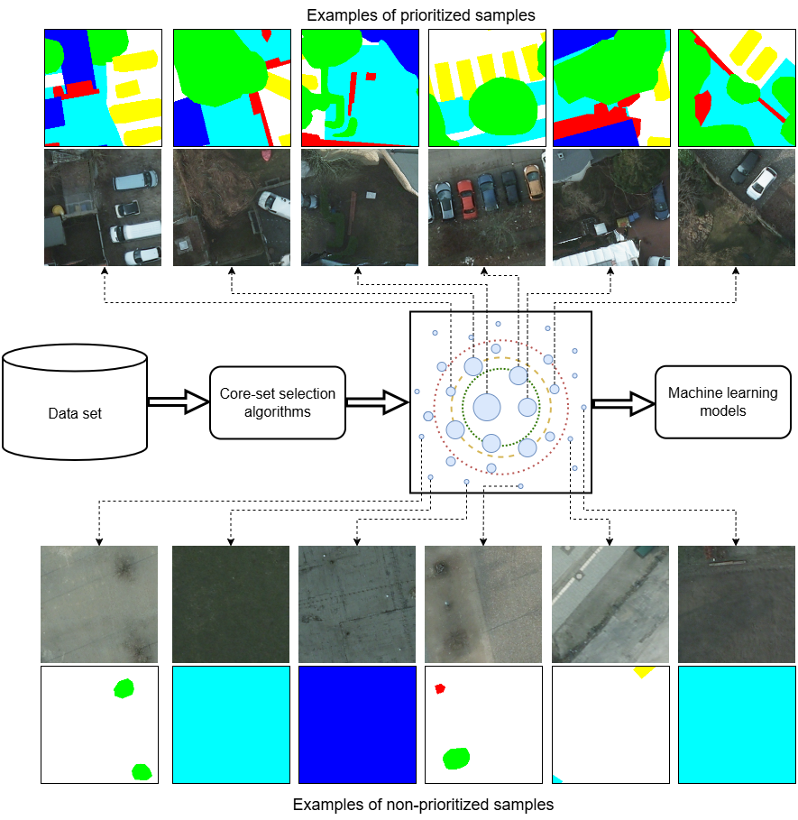

# Core-Set Selection for Data-efficient Land Cover Segmentation (IEEE Access 2026)



The increasing accessibility of remotely sensed data and their potential to support large-scale decision-making have driven the development of deep learning models for many Earth Observation tasks. Traditionally, such models rely on large datasets. However, the common assumption that larger training datasets lead to better performance tends to overlook issues related to data redundancy, noise, and the computational cost of processing massive datasets. Effective solutions must therefore consider not only the quantity but also the quality of data. Towards this, in this paper, we introduce six basic core-set selection approaches -- that rely on imagery only, labels only, or a combination of both -- and investigate whether they can identify high-quality subsets of data capable of maintaining -- or even surpassing -- the performance achieved when using full datasets for remote sensing semantic segmentation. We benchmark such approaches against two traditional baselines on three widely used land-cover classification datasets (DFC2022, Vaihingen, and Potsdam) using two different architectures (SegFormer and U-Net), thus establishing a general baseline for future works. Our experiments show that all proposed methods consistently outperform the baselines across multiple subset sizes, with some approaches even selecting core sets that surpass training on all available data. Notably, on DFC2022, a selected subset comprising only 25% of the training data yields slightly higher SegFormer performance than training with the entire dataset. This result shows the importance and potential of data-centric learning for the remote sensing domain.

## Installation and requirements

This project uses PyTorch 2.x. All necessary packages can be found in the requirements.txt.

## Usage

### Core-set methods

You can find some of proposed core-set methods [here](https://github.com/microsoft/data-centric-satellite-segmentation)

### Model training

#### Training

After generating the ranking of samples (from most to least important), you can train the models using the following command:

```
python train.py --config_file configs/your_config.yaml
```

You will need to create your own configuration file. Some example configuration files are provided in the `configs/` folder and can be used as a starting point.

The main section that typically needs to be modified is the **datamodule**, for example:

```
datamodule:
    dataset: "vaihingen"
    root_dir: "/YOUR_PATH/datasets/Vaihingen/"  # update this to point to your dataset
    train_coordinate_file_path: "coord_files/vaihingen_train_coordinate_list.txt"  # update with your generated ranking
    training_sample_perct: 1.0  # percentage - 1.0 = 100% ; 0.5 = 50% ; ... update accordingly
    val_image_file_path: "coord_files/vaihingen_val_image_list.txt"  # update with your validation file
```
Examples of both `train_coordinate_file_path` and `val_image_file_path` can be found in the `coord_files/` directory. This folder contains the rankings generated by all methods evaluated in the paper, for all datasets.

#### Inference

After training, you can perform inference using the following command:

```
python predict.py --config_file configs/your_config.yaml
                  --log_dir save_path/
```

## Datasets:

1. DFC2022: https://www.grss-ieee.org/community/technical-committees/2022-ieee-grss-data-fusion-contest/
2. Vaihingen and Potsdam: https://www.grss-ieee.org/community/technical-committees/2022-ieee-grss-data-fusion-contest/

## Citing

If you use this code in your research, please consider citing:

    @article{nogueira2026prototypical,
      title={Prototypical Contrastive Network for Imbalanced Aerial Image Segmentation},
      author={Nogueira, Keiller and Zaytar, Akram and Ma, Wanli and Roscher, Ribana and H{\"a}nsch, Ronny and Robinson, Caleb and Ortiz, Anthony and Nsutezo, Simone and Dodhia, Rahul and Ferres, Juan M Lavista and others}, 
      journal={IEEE Access},
      year={2026},
      publisher={IEEE}
    }

